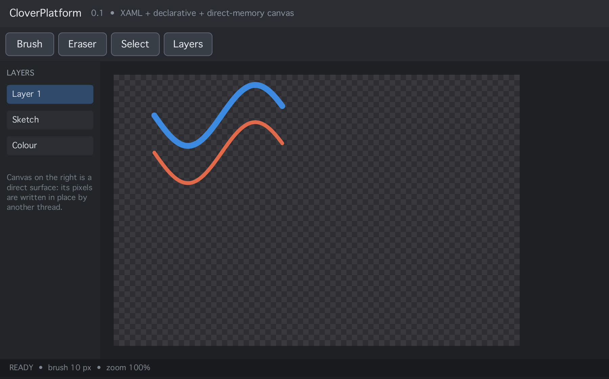
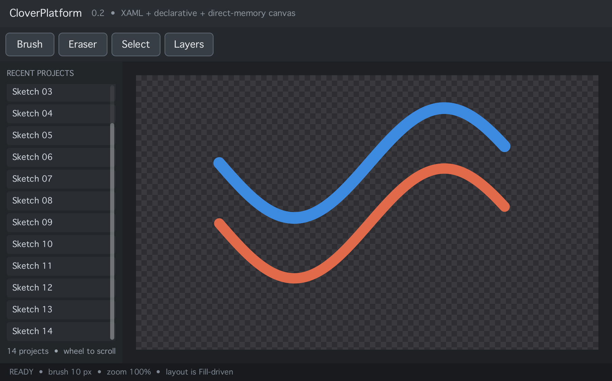
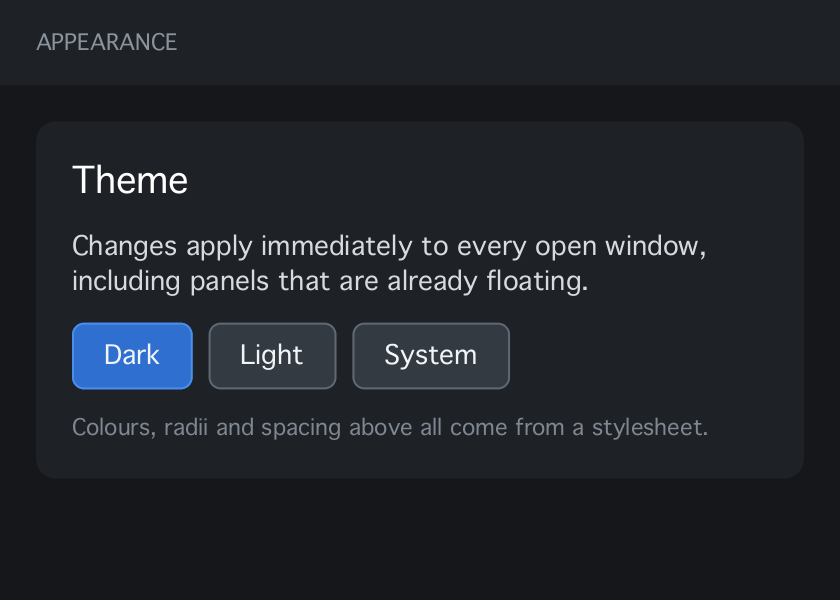
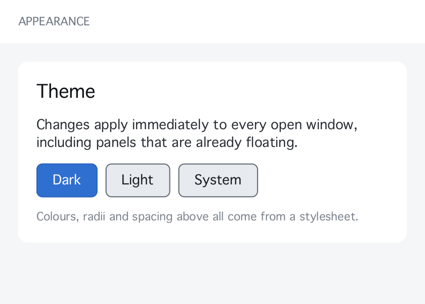
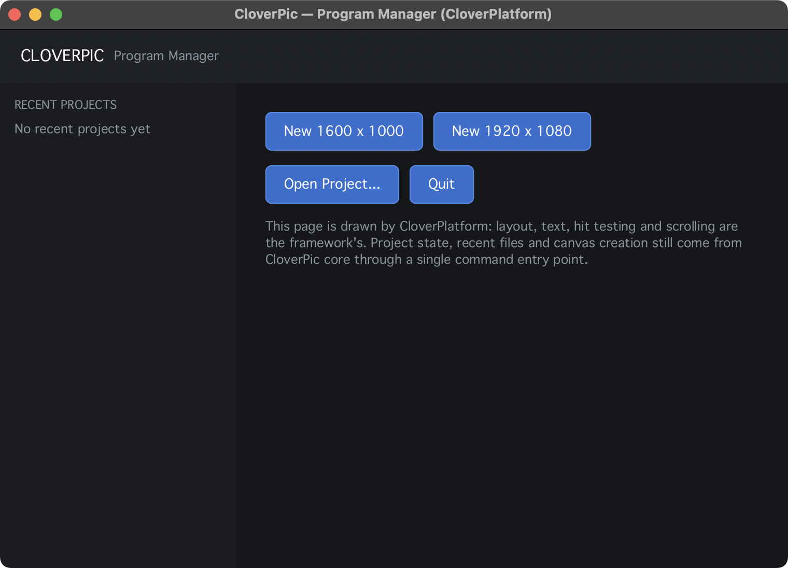
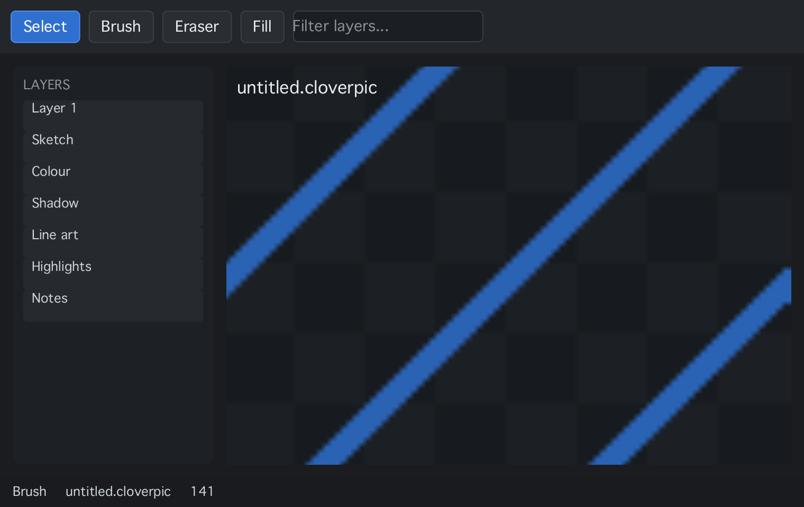

# CloverPlatform

A cross-platform UI and rendering framework written in Rust, with a CPU-first
renderer and a C ABI for native hosts. It is the UI substrate for
[CloverPic](https://github.com/CloverIris/CloverPic) and is developed as its own
repository so it can be reused elsewhere.





One page, two stylesheets — no colour appears in the markup:




And this is CloverPic's Program Manager, drawn by CloverPlatform instead of the
core-drawn scene. The buttons raise commands; core still owns the state machine.



A whole UI from one `.cui` file — data, styles, bindings and a scrollable list:



> Status: **0.11 — gradients, templates, animation**. The pipeline works end to end (tree →
> layout → display list → tile-parallel raster → frame), both authoring
> front-ends produce the same tree, layout supports flex-style `Fill`, text
> wraps, and keyboard focus is routed. Styles, templates, bindings and animation
> are not implemented yet; see [Roadmap](#roadmap).

## What it does

* **One tree, two authoring modes.** XAML (WPF/Avalonia/WinUI flavour) and
  Compose/Flutter-style declarative builders both produce the same `Node` tree,
  so they can be mixed anywhere, and a retained-mode shell can host declarative
  regions.
* **Retained and declarative in the same layout.** The mode is per-node.
* **CPU renderer with a parallel tile rasteriser.** Damage-driven: only the
  rectangles that changed are redrawn, split across cores with rayon.
* **Flex layout.** `Auto` / `Px` / `Percent` / `Fill`, main-axis distribution
  with `justify`, cross-axis alignment with `align`. Explicit sizes always win
  over stretch, matching WPF.
* **Text.** rustybuzz (HarfBuzz) shaping — ligatures, kerning and marks come out
  right — with per-character font fallback across faces, so CJK renders too.
  `.ttc` collections are supported, which is what macOS actually ships.
  Unicode line-break opportunities (UAX #14) drive wrapping, with hard breaks for
  words wider than the line; glyphs rasterise from TrueType outlines through
  `ab_glyph_rasterizer`.
* **Images.** PNG decoding; antialiased rectangles, rounded rectangles and
  borders.
* **Keyboard focus.** Tab / Shift+Tab traversal over focusable nodes, and key
  events routed through capture → target → bubble along the focused node.
* **UI documents.** One `.cui` file holds data, styles and the page:

  ```xml
  <Ui>
    <Data><Value Key="title" Text="Settings"/></Data>
    <Styles><Style TargetType="Button" Background="#2E6FD0" CornerRadius="6"/></Styles>
    <StackPanel><TextBlock Text="{Binding title}"/></StackPanel>
  </Ui>
  ```

* **Render context.** `RenderContext` describes the target (format, colour space,
  scale, viewport) and is what a GPU backend would consume. Format negotiation is
  explicit: the host states what it wants, the display states what it supports,
  and the result records *why* it fell back.
* **Grid layout.** `Grid Columns="3"` / `Node::grid(3)` places children in uniform
  cells, filling a definite height and sizing to content otherwise.
* **Brushes.** Solid colour, fitted/cropped texture (`BackgroundImage`), or a
  linear/radial gradient (`BackgroundGradient`, `GradientStops`).
* **Control templates.** `<Template x:Key="chip">` in a stylesheet replaces a
  control's visuals while keeping its properties; `{Binding Content}` and
  `{Binding Tag}` bind the control into the template.
* **Animation.** Opacity and background colour ease towards a target over a
  duration; `Surface::advance` returns whether more frames are needed, so hosts
  stop requesting frames when everything settles.
* **Stylesheets.** `<Styles>` with type, class, name and universal selectors,
  ordered by specificity. Styles provide defaults; attributes win; font size and
  text colour cascade.
* **Data binding.** `{Binding key}` in any attribute or inline in text
  (`"3 of {Binding total}"`), resolved at build time from a flat key → value map.
  Typed values (colour, number, bool) bypass the string round-trip.
* **Editable text fields.** `<TextBox>` supports focus, caret, typing,
  backspace/delete, arrows, Home/End and Enter-to-submit, and reports
  `text:<name>` / `submit:<name>` actions.
* **Input methods.** Composing text (Chinese, Japanese, Korean) is previewed
  inline with an underline and only committed on confirmation. The platform's
  input client drives it; the candidate window anchors to the framework's caret
  rectangle.
* **Scrolling.** Vertical scroll containers (`ScrollViewer`, `Node::scrollable`)
  clamp their offset against the laid-out content and paint a scrollbar. Wheel
  events route to the nearest scrollable ancestor.
* **Interaction feedback.** Hovered surfaces lighten and pressed ones darken by
  default, with no per-widget code.
* **Actions.** `Command="id"` on any element reports `id` to the host when it is
  clicked, or when Enter/Space is pressed on a focused descendant. Press and
  release must land on the same node, like any desktop toolkit. The framework
  decides *when*, the host decides *what*.
* **Hosts.** A C ABI, exercised by CloverPic's macOS adapter; see
  [docs/MIGRATION.md](docs/MIGRATION.md).
* **Direct-memory child surfaces.** A region of the UI can be handed to another
  thread as a raw pixel buffer with swap-chain semantics — this is how a paint
  canvas keeps its own high-refresh-rate loop.
* **C ABI.** Embed the whole thing in a C/C++/Objective-C++ host.

## Layout

```text
crates/
  clover-core/      geometry, colour (straight + premultiplied), damage, threading
  clover-ui/        node tree, two authoring modes, layout, XAML front-end, events
  clover-render/    CPU canvas, text, images, display list, tile renderer, surfaces
  clover-abi/       C ABI (cdylib + staticlib)
  clover-demo/      headless demo that renders a mixed UI to PNG
include/
  clover_platform.h C header for native hosts
tests/
  abi_smoke.cpp     C++ host smoke test
```

## Build and test

```bash
cargo test                     # unit tests for every crate
cargo run --release -p clover-render --example bench_surface   # frame-cost guard
cargo run -p clover-demo       # renders demo.png and prints timings
```

C ABI smoke test (from the repository root):

```bash
cargo build -p clover-abi
clang++ -std=c++20 tests/abi_smoke.cpp -I include \
        target/debug/libclover_abi.a -o abi_smoke \
        -framework Security -framework CoreFoundation
./abi_smoke
```

## Hello world

Declarative:

```rust
use clover_core::{Color, Edges};
use clover_ui::node;

let page = node::column()
    .padding(Edges::all(16.0))
    .gap(8.0)
    .background(Color::rgb(0x1E, 0x20, 0x23))
    .child(node::text("Hello").font_size(20.0))
    .child(node::button("OK"));
```

XAML:

```rust
use clover_ui::xaml;

let page = xaml::parse(r##"
<StackPanel Padding="16" Spacing="8" Background="#1E2023">
    <TextBlock Text="Hello" FontSize="20"/>
    <Button Content="OK"/>
</StackPanel>"##, &xaml::NoImages)?;
```

A canvas region that another thread owns:

```rust
node::direct_surface(handle).size(Length::Fill, Length::Fill)
```

The two authoring modes are interchangeable: a XAML page can contain
declaratively built children (`Node::child`) and vice versa. Hosts react to
input by draining actions:

```objc
char buffer[128];
loop:
    clover_surface_pointer(surface, x, y, CLOVER_POINTER_DOWN, 1, mods);
    clover_surface_pointer(surface, x, y, CLOVER_POINTER_UP, 1, mods);
    while (clover_surface_take_action(surface, buffer, sizeof buffer) > 0) {
        if (strcmp(buffer, "toggle:canvas") == 0)
            clover_surface_set_visible(surface, "canvas", false);
    }
``` A retained-mode shell can mount a
declarative subtree at runtime:

```rust
let mount = tree.mount(shell_id, "toolbar", Box::new(|| build_toolbar()));
tree.invalidate_mount(mount);
tree.flush();   // reconciles by key, reusing node ids
```

## Rendering model

```text
UiTree ──layout──► absolute bounds ──build──► DisplayList (physical px)
                                                  │
                                    damage rects ─┴─► tiles ──rayon──► Canvas
                                                                        │
                                                          DirectSurface ─┘ composite
```

* Layout is a small flexbox: measure content, resolve `Auto`/`Px`/`Percent`,
  hand leftover main-axis space to `Fill` children, distribute the rest with
  `justify`, then place on the cross axis with `align`. Explicit sizes always
  win over `Stretch`.
* The display list is resolved in **physical pixels** and carries shaped glyphs
  and decoded images, so tile rendering touches no shared mutable state.
* Frames are premultiplied BGRA8 in `u32`, the same layout CloverPic's
  `RgbaFrame` uses.

## Roadmap

Near term:

- text runs with mixed styles (bold spans, ellipsis, alignment per run),
- control templates and `{Binding}` (styles are in; templating is next),
- focus visuals: the framework routes focus, skins still draw it,
- horizontal scrolling and scroll-into-view on focus,
- region-level opacity layers.

Later:

- scroll containers and virtualised lists,
- animation scheduler with frame pacing,
- GPU (Metal / D3D) backend behind the same `DrawCmd` stream,
- separate surface threads per subtree (the direct-surface model generalised).

## License

MIT. See [LICENSE](LICENSE).
